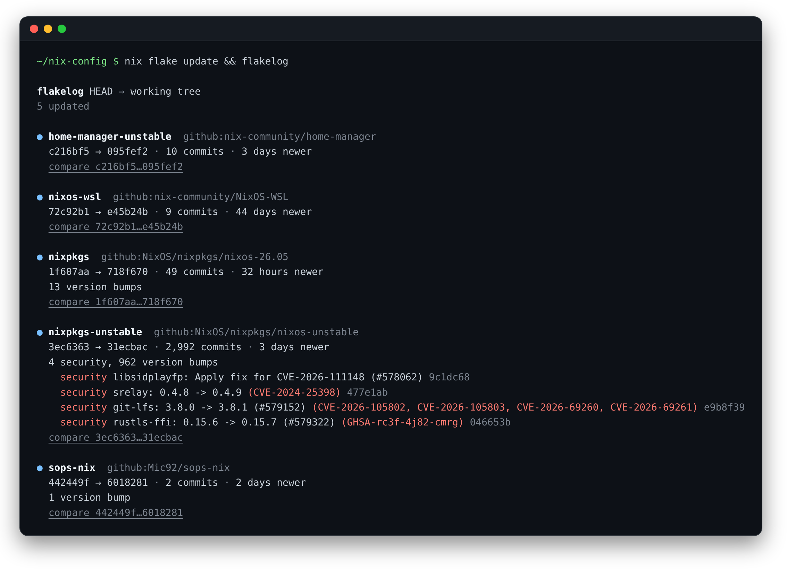
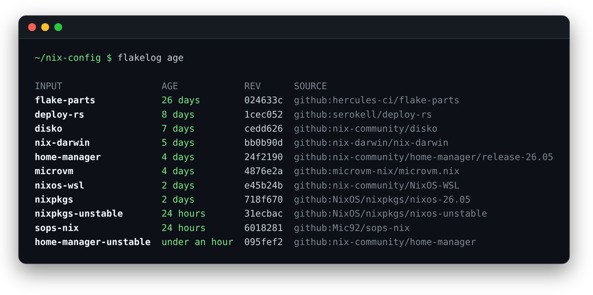

# flakelog

**A readable changelog for `flake.lock` updates.**

`nix flake update` tells you that `nixpkgs` moved from one hash to another. flakelog tells
you what that means: 2,992 commits, 3 days newer, 4 security fixes (with their CVEs), and
962 version bumps, with links to every commit.



- **Every input explained**: how many commits it moved, how far it jumped in time, and a
  compare link. Added, removed and retargeted inputs (new branch, now `follows`) are called out.
- **Notable commits surfaced**: security fixes (CVE/GHSA IDs, even when they're only in the
  commit body), breaking changes and reverts, ranked so the important ones come first.
  Squash-merge duplicates (`foo: fix` + `foo: fix (#123)`) are counted once.
- **Made for pull requests**: Markdown output for flake-update PR bodies. `#123` in an
  upstream commit links to the upstream PR (via `redirect.github.com`, so your PR doesn't
  spam a backlink onto it), and `@mentions` are defused so nobody gets pinged.
- **Fast on nixpkgs**: commit pages are fetched in parallel; a 3,000-commit nixpkgs jump takes ~6s.
- **`flakelog age`**: how stale each pinned input is.

## Install

```sh
nix run github:Fahnoee/flakelog            # try it
nix profile install github:Fahnoee/flakelog
```

Or add it to a flake (`inputs.flakelog.url = "github:Fahnoee/flakelog";`) and use
`flakelog.packages.${system}.default`. Without Nix: `go install github.com/Fahnoee/flakelog/cmd/flakelog@latest`.

## Usage

```sh
flakelog                      # HEAD vs working tree: run it right after `nix flake update`
flakelog HEAD~5               # everything since a revision
flakelog main my-branch       # two git revisions
flakelog old.lock new.lock    # two files
flakelog -all                 # include inputs of inputs
flakelog -f markdown          # for a PR body
flakelog -f json              # for scripts
flakelog age                  # how old each input is
```

Arguments are file paths if they exist, otherwise git revisions of the lock file
(`REV` or `REV:path/to/flake.lock`). Run `flakelog -h` for every flag.

Commit details come from the GitHub (and GitLab) compare APIs. flakelog picks up a token
from `GITHUB_TOKEN`, `GH_TOKEN` or `gh auth token`; without one, GitHub allows 60 requests an
hour, so flakelog scans only the first 100 commits per input. `-offline` skips the APIs
entirely and still shows revisions, dates and compare links.

Tokens are only ever sent to `github.com` (and `GITLAB_TOKEN` to `gitlab.com`): lock files of
third-party flakes can name any host, so inputs on other hosts are fetched anonymously.



## In a flake-update workflow

flakelog ships as a GitHub Action. Put it after `nix flake update` and use the Markdown as
the PR body:

```yaml
- uses: cachix/install-nix-action@v31
- run: nix flake update
- id: flakelog
  uses: Fahnoee/flakelog@main
- uses: peter-evans/create-pull-request@v8
  with:
    title: "flake.lock: update"
    body-path: ${{ steps.flakelog.outputs.markdown-file }}
    add-paths: flake.lock
```

| Input | Default | |
|---|---|---|
| `from` | `HEAD` | old lock file or git revision |
| `to` | working tree | new lock file or git revision |
| `lock` | `flake.lock` | path to the lock file |
| `all` | `false` | include inputs of inputs |
| `notable` | `8` | notable commits listed per input |
| `heading` | summary | Markdown heading |
| `output` | `flakelog.md` | where to write the Markdown (also added to the job summary) |
| `github-token` | `github.token` | token for the GitHub API |

The Markdown looks like this (real output):

> ### flake.lock: 5 updated
>
> | Input | Change | Commits | Jump | Notable |
> |---|---|---|---|---|
> | **home-manager-unstable** | [`c216bf5` → `095fef2`](https://github.com/nix-community/home-manager/compare/c216bf5a1f173b0481bd5c8c489ebe5595ecc68c...095fef2f265c3c0da4fe315efba8f8a04495ab34) | 10 commits | 3 days newer |  |
> | **nixos-wsl** | [`72c92b1` → `e45b24b`](https://github.com/nix-community/NixOS-WSL/compare/72c92b11bb8289e6651c7fef29cc0a885fd6a255...e45b24b7df093299072b13bf3144ed0ee340e769) | 9 commits | 44 days newer |  |
> | **nixpkgs** | [`1f607aa` → `718f670`](https://github.com/NixOS/nixpkgs/compare/1f607aa79b6356ed45d3cd3c8079c196e79efa2c...718f670e845328e9c2cecdd832835712b2cbd065) | 49 commits | 32 hours newer | 13 version bumps |
> | **nixpkgs-unstable** | [`3ec6363` → `31ecbac`](https://github.com/NixOS/nixpkgs/compare/3ec636362e1816bc2f0888fa0fa2c69f1bc9e504...31ecbaca1bdefa45dffc409f0250bd8039ea0010) | 2,992 commits | 3 days newer | 4 security, 962 version bumps |
> | **sops-nix** | [`442449f` → `6018281`](https://github.com/Mic92/sops-nix/compare/442449fa7b1fe6c692d0103ac9fc8f9e82931cf3...60182817ee048ac94b4c68ea76d5ef2e8aac730d) | 2 commits | 2 days newer | 1 version bump |
>
> <details><summary><b>nixpkgs-unstable</b>: 4 notable commits</summary>
>
> - **security** libsidplayfp: Apply fix for CVE-2026-111148 ([#578062](https://redirect.github.com/NixOS/nixpkgs/issues/578062)) ([`9c1dc68`](https://github.com/NixOS/nixpkgs/commit/9c1dc6804e91bad4c21240b575f24c5e8f530bd9))
> - **security** srelay: 0.4.8 -> 0.4.9 · mentions CVE-2024-25398 ([`477e1ab`](https://github.com/NixOS/nixpkgs/commit/477e1abe6489fbce759a20f27e54113431cbee91))
> - **security** git-lfs: 3.8.0 -> 3.8.1 ([#579152](https://redirect.github.com/NixOS/nixpkgs/issues/579152)) · mentions CVE-2026-105802, CVE-2026-105803, CVE-2026-69260, CVE-2026-69261 ([`e9b8f39`](https://github.com/NixOS/nixpkgs/commit/e9b8f39cde02437ea226ede3ed3c75881c3f8106))
> - **security** rustls-ffi: 0.15.6 -> 0.15.7 ([#579322](https://redirect.github.com/NixOS/nixpkgs/issues/579322)) · mentions GHSA-rc3f-4j82-cmrg ([`046653b`](https://github.com/NixOS/nixpkgs/commit/046653b34e7bef31e9da625be12dcf8755324921))
>
> </details>

flakelog explains the *inputs*. For a NixOS system, pair it with
`nix store diff-closures` to see which package versions actually changed in your closure.

## How notable commits are picked

| Tag | Matches |
|---|---|
| security | a CVE or GHSA ID anywhere in the message, or "security" / "vulnerability" / "exploit" in the title (NixOS options like `security.sudo` don't count) |
| breaking | "breaking" in the title, Conventional Commits `feat!:`, or `BREAKING CHANGE` in the body |
| revert | titles starting with "Revert" |
| version bump | nixpkgs-style `foo: 1.2 -> 1.3` or Dependabot-style `bump foo from 1.2 to 1.3` (counted, not listed) |

## Development

```sh
nix develop      # Go toolchain
go test ./...
nix build        # ./result/bin/flakelog
```

## License

MIT
